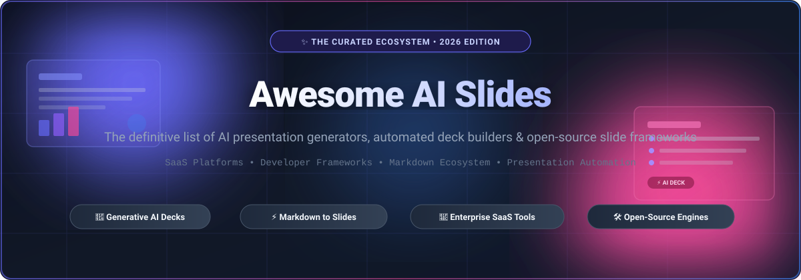
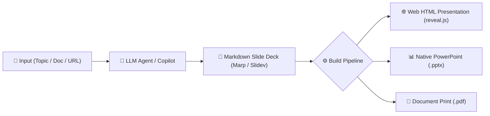

  

# 🚀 Awesome AI Slides

  
  
  
  
  
  
  

---

> **A curated showcase of top SaaS platforms, AI-native presentation generators, deck automation engines, and open-source slide frameworks.**  
> *Everything you need to generate, automate, and publish slide decks from prompts, documents, or Markdown.*

---

## 📑 Table of Contents

- [🌐 Sector Overview & Market Dynamics](#-sector-overview--market-dynamics)
- [💼 SaaS & Hosted AI Slide Platforms](#-saas--hosted-ai-slide-platforms)
- [💻 Open-Source GitHub Projects](#-open-source-github-projects)
- [🏗️ Architectural Recipes for Custom Decks](#-architectural-recipes-for-custom-decks)
- [🤝 How to Contribute](#-how-to-contribute)
- [💖 Support & Sponsoring](#-support--sponsoring)
- [📈 Star History](#-star-history)
- [⚖️ Disclaimer & Ethics](#️-disclaimer--ethics)

---

## 🌐 Sector Overview & Market Dynamics

* **Estimated Market Size**: The global presentation software market is valued at **$8.5B–$9.6B** in 2026 (advancing at a **13%–15% CAGR** towards $25B+ by the 2030s), while the dedicated **AI presentation generation sub-sector** has surged to **$2.0B–$2.4B**, growing at a rapid **~25.5% CAGR** as prompt-to-deck workflows, generative design agents, and automated data visualizations redefine slide creation.
* **Fragmentation & Industry Concentration**: The market exhibits a **bifurcated structure**—the legacy enterprise productivity suite layer is **moderately concentrated** around mega-cap incumbents (**Microsoft Copilot for PowerPoint** and **Canva**) that wield massive distribution moats, whereas the innovative prompt-to-canvas presentation tier remains **highly fragmented and hyper-competitive** among venture-backed challengers (**Gamma**, **Beautiful.ai**, **Tome**, **Pitch**) and developer-first open-source engines (**Slidev**, **Marp**, **reveal.js**) competing for next-generation interactive visual workflows.

---

## 💼 SaaS & Hosted AI Slide Platforms

*The following table catalogs leading hosted AI presentation generators, sorted descending by **Company Size (Valuation / Revenue)**.*

| 🏢 Platform | 📊 Company Size (Valuation / Revenue) | 💳 Starting Paid Tier | 🎁 Free Tier Limits & Trial Terms | ⚡ Key Capabilities & Description |
|:---|:---|:---|:---|:---|
| **[Microsoft Copilot for PowerPoint](https://www.microsoft.com/microsoft-365)** | **~$3.1 Trillion Market Cap** / $245B+ Annual Revenue | **$20.00/user/mo** (Copilot Pro) or **$30.00/user/mo** billed annually (Copilot for Microsoft 365) | **No permanent free tier**. Offers a 30-day free trial of Copilot Pro (credit card required; auto-renews at $20/mo; requires existing M365 subscription). | Deeply integrated PowerPoint assistant; converts Word docs or prompts into formatted presentations with speaker notes, corporate layouts, and enterprise data security. |
| **[Canva AI Presentations](https://www.canva.com/)** | **~$26.0 Billion Valuation** / $2.5B+ Annual Revenue | **$12.50/user/mo** billed annually ($150/yr) or **$15.00/mo** monthly (Canva Pro) | **Free forever plan** with 5 GB cloud storage, 50 lifetime Magic Design generations, and 500 lifetime Magic Write credits; downloads include watermark on premium assets. | Full design ecosystem integration; generates multi-page slide decks from simple prompts, auto-suggests color palettes, charts, stock media, and animated transitions. |
| **[Slidesgo AI Presentation Maker](https://slidesgo.com/ai-presentations)** | **~$700 Million Valuation** (Freepik Company) / $100M+ Annual Revenue | **$5.99/mo** billed monthly or **$23.99/yr** billed annually (Slidesgo Premium) | **Free forever plan** limited to 5 presentation downloads per month with mandatory author attribution link; restricted to free catalog templates. | Generates customizable presentation outlines and slide designs using Freepik's expansive vector and icon library; full export support for PPTX and Google Slides. |
| **[Genspark](https://www.genspark.ai/)** | **~$500 Million Valuation** / $60 Million Seed Funding (Mainstream Network) | **$19.99/mo** billed annually or **$24.99/mo** monthly (Plus Plan) | **Free plan with 100 credits/day** capped by a cumulative lifetime ceiling; 1 GB AI Drive storage; native PPTX file downloads are locked to paid tiers. | AI Super Agent workspace that generates structured slide decks alongside docs and sheets; includes integrated live web research, citation cards, and editable slide canvases. |
| **[Tome](https://tome.app/)** | **~$300 Million Valuation** / $75 Million Total Funding | **$16.00/user/mo** billed annually ($192/yr) or **$20.00/mo** monthly (Pro Plan) | **Free plan with 500 one-time starter AI credits** upon signup; mandatory Tome branding watermark on links; export to PDF or PPTX is disabled. | AI-native storytelling workspace with responsive fluid tile layouts; transforms outlines into interactive presentation pitches with live web embeds and sales enablement tools. |
| **[Pitch](https://pitch.com/)** | **~$300 Million Valuation** / $135 Million Total Funding | **$17.00/seat/mo** billed annually ($204/yr) or **$22.00/seat/mo** monthly (Pro Plan) | **Free forever workspace** for up to 5 members, 2 external guests, and 1 teamspace; unlimited presentations but includes Pitch branding; custom fonts and granular analytics locked. | Modern collaborative presentation platform featuring AI prompt-to-deck creation, automated slide reformatting, real-time co-authoring, and viewer engagement analytics. |
| **[Gamma](https://gamma.app/)** | **~$150M–$250 Million Valuation** / $12 Million Series A Funding | **$10.00/user/mo** billed annually ($120/yr) or **$12.00/mo** monthly (Plus Plan) | **Free plan with 400 one-time starter AI credits** (no monthly refill); capped at 10 cards per prompt; includes "Made with Gamma" badge; basic 7-day analytics. | Generates presentations, webpages, and docs from natural language prompts; features interactive widgets, responsive card layouts, and export to PDF, PPTX, and Google Slides. |
| **[Beautiful.ai](https://www.beautiful.ai/)** | **~$80M–$100 Million Valuation** / $12M+ ARR ($16M Funding) | **$12.00/mo** billed annually ($144/yr) for Pro Plan, or **$45.00** for a single ad-hoc presentation | **No permanent free tier**. Offers a 14-day free trial with full Pro features (credit card required upfront; automatically renews to $144/yr if not cancelled). | DesignerBot AI engine with Smart Slides that dynamically recalibrate layouts, spacing, and typography as content is typed; enforces strict brand guidelines. |
| **[Plus AI](https://www.plusai.com/)** | **~$20 Million Valuation** / $3.5 Million Seed Funding (Plus Docs) | **$10.00/user/mo** billed annually ($120/yr) or **$15.00/mo** monthly (Basic Plan) | **No permanent free tier**. Offers a 7-day free trial with 1,000 trial AI credits (credit card required upfront; auto-renews unless cancelled). | AI presentation add-in for Google Slides and Microsoft PowerPoint; creates structured slide outlines, full presentations, and localized rewrite suggestions in native formats. |
| **[Presentations.AI](https://www.presentations.ai/)** | **~$15 Million Valuation** / $1.5M ARR (Seed Stage) | **$16.00/user/mo** billed annually ($192/yr) or **$24.00/mo** monthly (Pro Plan) | **Free Starter plan** ($0, no card required) with 100 starter AI credits; max 20 slides per deck; zero file exports allowed (PPTX/PDF downloads locked). | "ChatGPT for presentations"; turns prompts, documents, or YouTube URLs into branded presentation decks; features adaptive styling and brand customization engines. |
| **[Decktopus](https://www.decktopus.com/)** | **~$10M–$15 Million Valuation** / $1M+ ARR (Seed Stage) | **$9.99/mo** billed annually ($119.88/yr) or **$14.99/mo** monthly (Pro Plan) | **Free trial deck generation** allowing 1 presentation deck (~3 slides); no PDF or PPTX exports; mandatory Decktopus watermark on exported links. | Form-guided presentation builder featuring automated content proposals, AI-generated speaker voice narration, embedded lead capture forms, and analytics. |
| **[SlidesAI](https://www.slidesai.io/)** | **~$3M–$5 Million Valuation** / $1M+ ARR (Bootstrapped Micro-SaaS) | **$10.00/mo** billed annually ($120/yr) or **$15.00/mo** monthly (Pro Plan) | **Basic Plan ($0/forever)** capped at 1 presentation per month; maximum 2,500 characters input per prompt; document file uploads disabled. | Google Workspace add-on that extracts key presentation points from unstructured text, automatically designs slides, and inserts speaker notes directly into Google Drive. |

---

## 💻 Open-Source GitHub Projects

*The following open-source engines, CLI utilities, and developer frameworks are sorted descending by **GitHub Stars**.*

1. **[reveal.js](https://github.com/hakimel/reveal.js)**  `MIT`  
   The foundational HTML presentation framework. Create modern interactive slides using HTML or Markdown with nested 2D slides, speaker notes, PDF exports, and an extensive plugin ecosystem.

2. **[PPT Master](https://github.com/hugohe3/ppt-master)**  `Apache-2.0`  
   AI agent that turns documents or topic prompts into native Microsoft PowerPoint (`.pptx`) decks with real vector shapes, transitions, animations, on-demand data charts, and audio narration.

3. **[Slidev](https://github.com/slidevjs/slidev)**  `MIT`  
   Presentation slides for developers powered by Vue and Vite. Write Markdown with Vue components, syntax highlighting, live coding, LaTeX formulas, Mermaid diagrams, and PDF/PNG/PPTX exports.

4. **[Pandoc](https://github.com/jgm/pandoc)**  `GPL-2.0`  
   The Swiss Army knife universal markup converter. Transforms Markdown and reStructuredText into PowerPoint (`.pptx`), LaTeX Beamer (`.pdf`), reveal.js, Slidy, and DZSlides.

5. **[impress.js](https://github.com/impress/impress.js)**  `MIT`  
   Presentation framework based on the power of CSS3 transforms and transitions in modern web browsers. Enables nonlinear, 3D infinite canvas presentations with zoom, tilt, and pan.

6. **[Remark](https://github.com/gnab/remark)**  `MIT`  
   Simple, in-browser, Markdown-driven slideshow tool. Formats Markdown into standalone HTML slides with syntax highlighting, dual-screen presenter view, and zero build setup.

7. **[Marp](https://github.com/marp-team/marp)**  `MIT`  
   The entry repository for the Markdown Presentation Ecosystem. Converts plain Markdown into slide decks via CLI, VS Code extension, or web frameworks with custom CSS themes and PDF/PPTX export.

8. **[Slides (Terminal)](https://github.com/maaslalani/slides)**  `MIT`  
   Terminal-based presentation tool written in Go. Allows developers to present directly from their command-line interface with Markdown parsing, syntax highlighting, and live code execution.

9. **[mdx-deck](https://github.com/jxnblk/mdx-deck)**  `MIT`  
   React MDX-based presentation decks. Write slide decks using MDX to seamlessly embed interactive React components, styled-system themes, presenter mode, and PDF exports.

10. **[Spectacle](https://github.com/FormidableLabs/spectacle)**  `MIT`  
    React-based library for creating sleek presentations using JSX syntax. Offers real-time live code demonstrations, modular slide templates, auto-formatting, and presenter notes.

11. **[WebSlides](https://github.com/webslides/WebSlides)**  `MIT`  
    Modular HTML and CSS presentation framework. Focused on clean typography, accessibility, and simplicity to build corporate slide decks, portfolios, and landing pages using semantic HTML.

12. **[Quarto CLI](https://github.com/quarto-dev/quarto-cli)**  `GPL-2.0`  
    Scientific and technical publishing system built on Pandoc. Outputs computational presentations via Reveal.js, PowerPoint, and Beamer with embedded Python, R, Julia, and Observable code cells.

13. **[Fusuma](https://github.com/hiroppy/fusuma)**  `MIT`  
    Tool for building slide decks using Markdown, CSS, and React. Supports live coding, timeline charts, presenter display, responsive layouts, and zero-configuration PDF generation.

14. **[Bespoke.js](https://github.com/bespokejs/bespoke)**  `MIT`  
    Ultra-lightweight DIY presentation micro-framework (~1KB). Provides a barebones slide harness with dozens of modular plugins for keys, touch gestures, animations, and VR support.

15. **[Marp CLI](https://github.com/marp-team/marp-cli)**  `MIT`  
    Official command-line interface for Marp and Marpit converters. Automates batch generation and headless conversion of Markdown slide decks into HTML, PDF, PPTX, and image snapshots.

16. **[DeckTape](https://github.com/astefanutti/decktape)**  `MIT`  
    High-quality automated PDF exporter for HTML presentation frameworks. Headless Chromium-based exporter compatible with reveal.js, Remark, Marp, WebSlides, DZSlides, and shower.

17. **[Landslide](https://github.com/adamzap/landslide)**  `Apache-2.0`  
    Python command-line slideshow generator. Compiles Markdown, ReStructuredText, or Textile documents into standalone HTML5 presentations with themes and syntax highlighting.

18. **[AiPPT](https://github.com/veasion/AiPPT)**  `Apache-2.0`  
    Open-source AI presentation generator that converts topics, documents, or URLs into structured PowerPoint decks. Supports native charts, 3D animations, custom templates, and online preview.

19. **[Hovercraft](https://github.com/regebro/hovercraft)**  `MIT`  
    Python utility creating 3D impress.js presentations from reStructuredText. Combines text authoring with 3D spatial positioning, presenter console, and math typesetting.

20. **[Marpit](https://github.com/marp-team/marpit)**  `MIT`  
    The core skinny slide deck framework powering the Marp ecosystem. Transforms Markdown and CSS into responsive slide HTML/CSS markup without any heavy JavaScript runtime dependencies.

21. **[DZSlides](https://github.com/paulrouget/dzslides)**  `DWTFYWTPL`  
    Single-file HTML5 presentation template. Compact zero-dependency boilerplate for rendering slides in modern browsers with integrated keyboard navigation and presenter notes.

---

## 🏗️ Architectural Recipes for Custom Decks

Combine the power of LLMs and open-source slide frameworks to build automated presentation generation pipelines:

* **Pipeline 1 (Markdown-First Automation)**: Feed outlines to an LLM API (e.g., Gemini, Claude, GPT-4) with strict formatting instructions -> Render with **[Slidev](https://github.com/slidevjs/slidev)** or **[Marp](https://github.com/marp-team/marp)** -> Export to PDF/PPTX via **[DeckTape](https://github.com/astefanutti/decktape)**.
* **Pipeline 2 (Native Office Automation)**: Ingest enterprise PDFs or reports -> Run through **[PPT Master](https://github.com/hugohe3/ppt-master)** or **[AiPPT](https://github.com/veasion/AiPPT)** -> Output fully editable native PowerPoint `.pptx` decks containing dynamic native vector charts.

---

## 🤝 How to Contribute

Contributions are warmly welcomed! Help keep this ecosystem comprehensive, accurate, and up-to-date:

1. 🍴 **Fork the repository**
2. 🌿 **Create a descriptive feature branch** (`git checkout -b add-tool-name`)
3. 📝 **Add or update an entry** following the existing format:
   * **For SaaS**: Name, URL, Company Size / Valuation, Starting Tier Price, Free Tier Limits, and a factual description.
   * **For Open-Source**: Name, Repository link, GitHub stars badge (`style=social&color=white`), license, and description.
4. 🚀 **Submit a Pull Request** with a brief summary of the addition or change.

---

## 💖 Support & Sponsoring

If you found **Awesome AI Slides** helpful for discovering tools, automating presentation workflows, or building your own slide platform, please consider supporting the project:

- ⭐ **Star this repository** to help others discover it across GitHub
- 🍴 **Fork and contribute** your favorite AI slide tools or frameworks
- 📢 **Share with your colleagues, engineering teams, and networks**
- ☕ **Buy me a coffee / Sponsor the project** on the [GitHub Sponsor Dashboard](https://github.com/sponsors/ishandutta2007)

Thank you for being part of the open-source presentation revolution! 🙌

---

## 📈 Star History

---

## ⚖️ Disclaimer & Ethics

* This repository is a **community-curated showcase** for informational purposes—inclusion does not constitute an endorsement.
* AI presentation generators producing content must comply with intellectual property rights, data privacy regulations, and image attribution standards.
* Always review LLM-generated slide decks for factual correctness, hallucinations, and brand alignment prior to client-facing or executive presentations.
